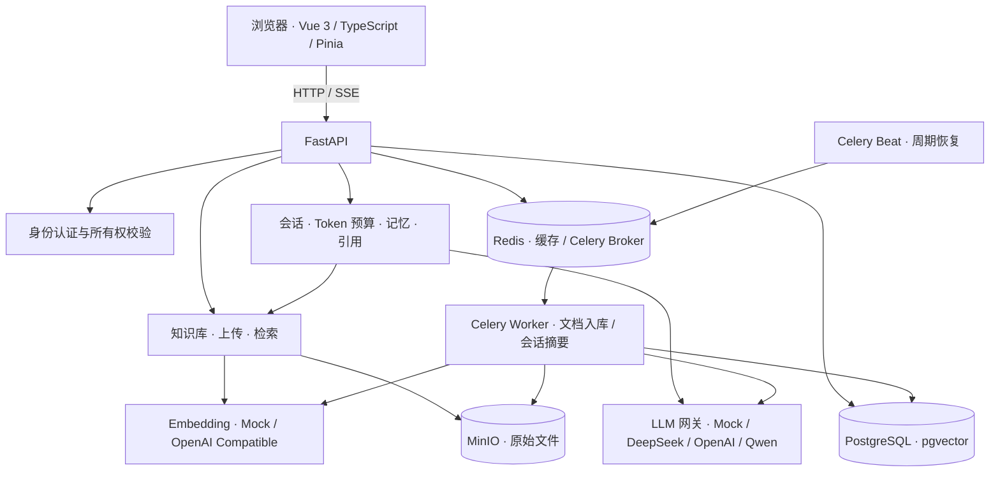

# Enterprise AI Assistant · 企业知识库智能助手

基于 **FastAPI + Vue 3 + PostgreSQL/pgvector** 的 AI 应用实践项目：上传企业资料，将知识库绑定到会话，通过流式问答获取带来源引用的回答。

项目重点覆盖真实 AI 应用的工程链路：用户隔离、异步文档入库、检索与证据筛选、长会话记忆、失败恢复，以及可复现的 RAG 评测。默认提供无需模型 API Key 的 Mock 模式，方便先跑通流程。

> 当前定位：持续迭代中的全栈演示与工程实践项目。已实现聊天与知识库 RAG；MCP 办公工具、多 Agent 工作流和人工审批属于后续方向。

## 目录

- [核心能力](#核心能力)
- [架构与技术栈](#架构与技术栈)
- [快速启动](#快速启动)
- [如何体验](#如何体验)
- [接入真实模型](#接入真实模型)
- [测试与评测](#测试与评测)
- [项目结构](#项目结构)
- [常见问题](#常见问题)
- [后续方向](#后续方向)

## 核心能力

| 能力 | 当前实现 |
| --- | --- |
| 账号与权限 | 注册、登录、JWT 身份验证、Argon2 密码哈希；按用户校验会话与知识库所有权 |
| 流式聊天 | SSE 增量回复、取消生成、失败重试、会话列表与管理；前端安全渲染 Markdown |
| 长会话记忆 | 按 Token 预算保留近期完整轮次，后台生成滚动摘要，控制上下文长度 |
| 知识库管理 | 创建、编辑、归档、恢复；每个会话最多绑定 5 个活动知识库 |
| 文档入库 | 文件上传到 MinIO，Celery 异步解析、Token 分块、Embedding 与向量持久化 |
| 多格式解析 | PDF、TXT、Markdown、DOCX、XLSX、PNG、JPEG；扫描 PDF 空文本页与图片使用本地 OCR |
| 检索与回答 | pgvector 候选召回，阈值或可选 LLM 二阶段证据筛选；证据不足时拒答 |
| 引用溯源 | 保存来源原文快照和结构化位置；按文件类型定位页码、标题路径、表格或单元格范围 |
| 任务可靠性 | PostgreSQL 持久化任务状态，支持领取控制、派发租约、重试退避、定时恢复和可恢复删除 |
| 运行记录与评测 | LLM 调用审计；版本化语料、问题集、检索指标与来源位置指标 |

## 架构与技术栈



- **后端**：Python 3.12+、FastAPI、Pydantic Settings、SQLAlchemy 异步会话、psycopg、Alembic。
- **前端**：Vue 3、TypeScript、Vite、Pinia、Vue Router、Marked、DOMPurify。
- **数据与任务**：PostgreSQL 17 + pgvector、Redis、MinIO、Celery Worker / Beat。
- **文档与 OCR**：pypdf、python-docx、openpyxl、PyMuPDF、RapidOCR + ONNX Runtime。
- **开发验证**：pytest、Ruff、Vitest、vue-tsc。

**文档链路**：上传 → 对象存储 → 持久化入库任务 → 解析与来源定位 → Token 分块 → Embedding → pgvector。

**问答链路**：身份验证 → 读取会话绑定 → 检索候选 → 筛选证据 → 构建带来源的提示词 → SSE 回复 → 保存消息与引用快照。

业务按 `identity`、`conversation`、`knowledge`、`llm_audit` 模块组织，并将模型、数据库、缓存、对象存储和队列适配放在基础设施层。混合检索的 lexical / RRF 组件及评测也已存在，当前在线搜索入口以向量召回与二阶段证据筛选为主。

## 快速启动

以下以 **Windows PowerShell** 为例。需要 Git、Python 3.12+、uv、Node.js 22.12+（或兼容当前 Vite 的更新版本）、Docker Desktop 与 Docker Compose。Compose 仅启动基础设施；前后端和任务进程在本机运行。

### 1. 克隆与安装依赖

```powershell
git clone https://github.com/kill-t/enterprise-ai-assistant.git
Set-Location enterprise-ai-assistant
# main 分支包含当前完整功能
git switch main

Set-Location backend
uv sync --locked
Set-Location ../frontend
npm ci
Set-Location ..
```

`uv sync` 会创建 `backend/.venv` 并安装项目及开发依赖。后续命令显式调用该虚拟环境，无需手动激活。

### 2. 准备配置

首次运行复制模板；已有本地配置时请保留原文件。

```powershell
Copy-Item backend/.env.example backend/.env
Copy-Item frontend/.env.example frontend/.env
backend/.venv/Scripts/python.exe -c "import secrets; print(secrets.token_urlsafe(32))"
```

把最后一条命令输出写入 `backend/.env` 的 `AUTH__SECRET_KEY`。首次体验保持以下配置：

```dotenv
AUTH__SECRET_KEY=替换为上一步生成的随机值
DEFAULT_PROVIDER=mock
EMBEDDING__PROVIDER=mock
RAG__EVIDENCE_SELECTOR=threshold
```

前端 `VITE_API_BASE_URL` 留空即可，开发服务器将 `/api` 代理到 `http://127.0.0.1:8000`。其余参数见 [后端配置模板](backend/.env.example) 与 [前端配置模板](frontend/.env.example)。

Mock 聊天与 Mock Embedding 均不调用远程模型，但仍走真实数据库、缓存、SSE 和任务处理链路。Mock Embedding 是稳定的 1024 维词项哈希向量，只用于流程验证，不能代表真实语义检索质量。

### 3. 启动基础设施与迁移

在仓库根目录执行：

```powershell
docker compose -f infra/docker/docker-compose.yml up -d
docker compose -f infra/docker/docker-compose.yml ps
Set-Location backend
.\.venv\Scripts\python.exe -m alembic upgrade head
```

首次拉取镜像需要等待。若数据库连接失败，确认 PostgreSQL 容器已就绪后再执行迁移。

### 4. 启动应用

分别打开四个终端，按标注切换目录后执行：

```powershell
# 终端 1：backend 目录，启动 API
.\.venv\Scripts\python.exe -m app.local_server
```

```powershell
# 终端 2：backend 目录，消费摘要与文档入库队列
.\.venv\Scripts\celery.exe -A app.infrastructure.task_queue.celery_app:celery_app worker --loglevel=INFO --pool=solo --queues=conversation-summary,document-ingestion
```

```powershell
# 终端 3：backend 目录，周期恢复到期或遗失的任务
.\.venv\Scripts\celery.exe -A app.infrastructure.task_queue.celery_app:celery_app beat --loglevel=INFO
```

```powershell
# 终端 4：frontend 目录，启动前端
npm run dev
```

Windows 使用项目的 `app.local_server` 入口适配 psycopg 异步事件循环，Worker 使用 `solo` 池。仅体验基础聊天可以暂不启动 Worker / Beat；完整的文档入库、滚动摘要和任务恢复需要它们。

| 入口 | 地址 |
| --- | --- |
| 前端页面 | http://127.0.0.1:5173 |
| Swagger API 文档 | http://127.0.0.1:8000/docs |
| 健康检查 | http://127.0.0.1:8000/health，响应中 `data.status` 应为 `ok` |
| MinIO 控制台 | http://127.0.0.1:9001，本地默认账号 / 密码均为 `minioadmin` |

停止各应用进程后，可在仓库根目录运行以下命令停止基础设施并保留数据：

```powershell
docker compose -f infra/docker/docker-compose.yml stop
```

配置中的数据库、Redis 和 MinIO 凭据只适用于本机开发。对外部署前需配置凭据、访问控制、网络和持久化策略；不要提交 `.env` 或私有业务资料，也不要使用 `down -v` 停止日常开发环境，它会删除数据卷。

## 如何体验

1. 打开前端，注册账号并登录，创建会话，先验证普通聊天、流式回复和失败重试。
2. 创建知识库，上传 [演示资料](backend/evaluation/corpus/enterprise-ai-rag-demo.md)。
3. 等待文档状态变为 `READY`。页面会轮询状态；失败时可查看错误并重试。
4. 在会话详情中选择并保存知识库绑定，再提出资料中有明确依据的问题。
5. 查看回答下方的引用卡片，核对文件名、原文和来源位置；刷新页面确认历史引用仍然存在。
6. 提出资料未覆盖的问题，观察证据不足时的拒答行为。

默认单文件大小上限为 20 MiB。扫描 PDF 的空文本页及 PNG/JPEG 会在 Worker 中使用本地 OCR，不需要 OCR API Key；首次加载模型通常更慢。默认最多处理 50 个 OCR PDF 页，并限制图片像素与尺寸。

使用 Mock 可以验证交互与检索链路；体验真实自然语言回答，请按下一节切换模型。更换 Embedding 模型后，应重新创建对应知识库并重新上传资料，避免新旧向量混用。

## 接入真实模型

聊天生成、向量化、证据筛选是三个独立配置。以下示例沿用仓库配置模板中的模型名称；可用模型及调用费用以服务商实际账号为准。

### 聊天模型

在本地 `backend/.env` 中修改，例如：

```dotenv
DEFAULT_PROVIDER=deepseek
DEEPSEEK__API_KEY=你的密钥
DEEPSEEK__MODEL=deepseek-v4-flash
DEEPSEEK__MAX_OUTPUT_TOKENS=4096
DEEPSEEK__THINKING_ENABLED=false
```

也可通过 `DEFAULT_PROVIDER=openai` 及 `OPENAI__*` 参数使用 OpenAI。完整参数以 [配置模板](backend/.env.example) 和 [配置代码](backend/app/core/config.py) 为准。

### 真实 Embedding

```dotenv
EMBEDDING__PROVIDER=openai_compatible
EMBEDDING__API_KEY=你的密钥
EMBEDDING__BASE_URL=https://dashscope.aliyuncs.com/compatible-mode/v1
EMBEDDING__MODEL=text-embedding-v4
EMBEDDING__DIMENSION=1024
```

当前数据库向量维度固定为 1024，接入的模型与返回维度必须匹配。知识库会记录 Embedding Profile，查询与存储向量需保持兼容。

### 可选 LLM 证据筛选

```dotenv
RAG__EVIDENCE_SELECTOR=llm
DEEPSEEK__API_KEY=你的密钥
RAG__LLM_EVIDENCE_SELECTOR_MODEL=deepseek-v4-flash
RAG__LLM_EVIDENCE_SELECTOR_THINKING_ENABLED=false
```

默认 `threshold` 使用阈值筛选；`llm` 会产生额外远程调用，并同时影响知识库搜索与会话 RAG。模型故障会返回明确错误，不会静默退回阈值模式。修改配置后重启 API 与 Worker；停止 LLM 筛选时改回 `threshold`。

## 测试与评测

### 开发检查

```powershell
# backend 目录
uv run pytest
uv run ruff check .
```

```powershell
# frontend 目录
npm run test:run
npm run build
```

测试覆盖认证与所有权、会话消息状态、SSE、摘要任务、文档解析与恢复、检索及引用等链路。上述为完整开发检查入口，具体依赖以各测试的 fixture 和配置为准。

### 无外部服务的多格式回归评测

在 `backend` 目录执行：

```powershell
.\.venv\Scripts\python.exe -m app.modules.knowledge.evaluation.offline_cli `
  --corpus-directory "evaluation\corpus\multiformat-v3" `
  --dataset "evaluation\datasets\rag-v3-multiformat.jsonl" `
  --top-k 3 `
  --similarity-threshold 0.2 `
  --output-directory "evaluation\reports" `
  --report-name "rag-v3-multiformat-mock-local"
```

该评测运行正式 Parser、Chunker 和 Mock Embedding，在进程内检索，不依赖 PostgreSQL、MinIO 或 API Key。固定语料覆盖七类格式，共 35 题（28 道可回答题、7 道拒答题）。

仓库保存的 [多格式 Mock 基线](backend/evaluation/baselines/rag-v3-multiformat-mock.md) 为：Recall@3 **85.71%**、MRR **85.71%**、整体行为准确率 **88.57%**、拒答题准确率 **100%**、来源位置准确率 **85.71%**。这些是固定小数据集上的解析与检索回归指标，不代表生产问答准确率；该评测不验证最终生成答案的质量。

在线检索评测、困难集与真实 Embedding 对照见 [评测说明](backend/evaluation/README.md)。临时报告默认写入被 Git 忽略的 `evaluation/reports/`，版本化基线需人工检查与脱敏。

## 项目结构

```text
enterprise-ai-assistant/
├── backend/
│   ├── app/
│   │   ├── modules/
│   │   │   ├── identity/       # 注册、登录、当前用户
│   │   │   ├── conversation/   # 会话、消息、流式回复、摘要、引用
│   │   │   ├── knowledge/      # 知识库、文档、解析、检索、评测
│   │   │   └── llm_audit/      # 模型调用审计
│   │   ├── infrastructure/    # 数据库、缓存、模型、对象存储、队列
│   │   ├── core/              # 配置、日志、安全
│   │   └── common/            # 通用响应、异常、依赖
│   ├── migrations/            # Alembic 数据库迁移
│   ├── tests/                 # 后端测试
│   ├── evaluation/            # 语料、数据集、版本化基线
│   ├── pyproject.toml
│   └── uv.lock
├── frontend/                  # Vue 页面、API 客户端、Store 与组件
├── infra/docker/              # PostgreSQL、Redis、MinIO Compose
├── docs/learning/             # 分阶段实现与验证笔记
└── scripts/                   # 辅助脚本预留目录
```

继续阅读：[本地运行补充](backend/README.md) · [实现与学习笔记索引](docs/learning/README.md) · [配置结构说明](docs/configuration-structure.md)。代码与当前首页反映已落地能力，早期设计文档包含尚未实施的规划。

## 常见问题

| 现象 | 排查方式 |
| --- | --- |
| API 启动时提示认证配置缺失 | 检查 `backend/.env`，填写至少 32 字节的安全随机 JWT 密钥，并从 `backend` 目录启动 |
| 数据库连接失败或缺表 | 检查 Docker Desktop、5432 端口和容器状态，执行 `alembic upgrade head` |
| 上传后一直等待 | 检查 Worker 是否消费 `document-ingestion` 队列、Redis 是否可连接；确认 Beat 正在运行以便恢复遗漏任务 |
| 有知识库但聊天没有引用 | 确认文档为 `READY`，会话已保存活动知识库绑定，且问题有足够相关证据 |
| Mock 检索漏掉同义表达 | 哈希向量不理解真实语义；接入真实 Embedding 后重新建库入库，再运行对应评测 |
| 修改配置没有生效 | 重启 API 与 Worker，检查启动目录和实际加载的 `.env` |
| 回答因长度限制失败 | 按模型能力调整输出 Token 预算；系统将截断回答标记为可重试失败，避免当作完整答案保存 |
| OCR 文档处理较慢 | 查看 Worker 日志，确认未超过图片尺寸或扫描页数限制；首次模型加载需额外时间 |

## 后续方向

- 扩大真实业务风格语料与问题集，持续验证召回、证据筛选、拒答和来源定位。
- 在已有 lexical / RRF 组件基础上继续验证混合检索方案。
- 逐步引入 MCP 办公工具、受控多 Agent 工作流与人工审批。
- 完善部署、运行观测与任务执行治理。

这些方向不属于当前已完成能力，具体实现以代码与版本记录为准。
